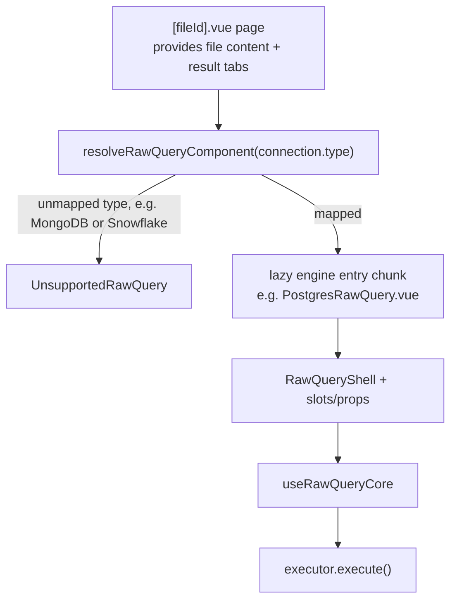

# Raw Query Architecture

The `components/modules/raw-query` module is the **engine-agnostic core** of the interactive query editor in OrcaQ.
Everything that is specific to a database engine lives in `components/modules/driver/<engine>/raw-query/`.
The core never names an engine: it receives a **descriptor** (static configuration) and an **executor** (how to run a statement) from the engine entry that mounts it.

## 1. Directory Structure

### Core (`components/modules/raw-query/`)

```text
raw-query/
├── shell/                # RawQueryShell.vue: the editor page shell (slots, props, expose)
├── contracts/            # RawQueryCapabilities, RawQueryExecutor, RawQueryDriverDescriptor, handler types
├── components/           # Presentation UI (Header, Footer, ResultTabs, dialogs, result-tab views)
├── hooks/                # Business logic (useRawQueryCore, useQueryExecution, useSqlEditorExtensions, ...)
├── services/             # sqlStreamingExecutor (default executor for SQL engines)
├── modules/chart-builder/ # Chart view for result tabs (its own sub-module)
├── interfaces/           # UI-boundary types (ExecutedResultItem, ViewMode, chart enums)
├── constants/            # Core constants
├── utils/                # Pure helpers (resolveStatementMode, extractVariables, completion sources, ...)
└── docs/                 # This documentation
```

### Driver layer (`components/modules/driver/`)

```text
driver/
├── <engine>/raw-query/               # postgres, mysql, mariadb, sqlite, oracle, mssql, redis
│   ├── capabilities/                 # <ENGINE>_RAW_QUERY_CAPABILITIES
│   ├── descriptors/                  # <ENGINE>_RAW_QUERY_DESCRIPTOR (thin SQL engines and Redis)
│   ├── services/                     # command-result handler and/or executor
│   ├── hooks/                        # engine hooks (Postgres, Redis only)
│   ├── containers/<Engine>RawQuery.vue  # the engine entry the resolver mounts
│   └── index.ts                      # root barrel, WITHOUT containers/
└── shared/
    ├── raw-query/                    # resolvers, unsupported state, constants/ (command categories), shared command-result handlers
    └── sql/raw-query/containers/BaseSqlRawQuery.vue   # default entry for plain SQL engines
```

Engines with more than the basics add sub-folders: PostgreSQL has `explain/`, `components/`, `constants/`, `types/`;
Redis has `components/` (database picker) and `utils/`; its hook `useRedisRawQuery` builds on `driver/redis/quick-query/hooks/useRedisWorkspace`.
To add an engine, follow `components/modules/driver/shared/raw-query/docs/ADDING_AN_ENGINE.md`.

## 2. Core / Driver Boundary

| Direction            | Rule                                                                                                                                                      |
| -------------------- | --------------------------------------------------------------------------------------------------------------------------------------------------------- |
| Core -> driver       | Never. The core does not import `components/modules/driver/**`, never imports `DatabaseClientType` as a value and never names an engine in a conditional. |
| Driver -> core       | Allowed through the core's public entries: `contracts`, `services`, `shell`, `hooks`, `interfaces`.                                                       |
| Engine A -> engine B | Never. Shared code goes to `driver/shared/`.                                                                                                              |

`driver/shared/raw-query` is the registry: `resolveRawQueryDescriptor.ts` imports each engine's `capabilities`, `descriptors` and `services` subpaths. In the other direction, engine code outside `containers/` imports only the `driver/shared/raw-query/services` sub-barrel (shared command-result handlers), never the shared root barrel, which imports the engines' descriptors. Engine containers do import the shared root barrel (`resolveCommandResultHandler`) and `driver/shared/sql/raw-query`.

The core rule is enforced by `test/unit/components/modules/raw-query/coreHasNoEngineKnowledge.spec.ts`.

Two deliberate layering exceptions, both to avoid an import cycle or a layer skip:

- **Driver root barrels do not export `containers/`.** Containers import `driver/shared/raw-query`, and `driver/shared/raw-query` imports each driver's descriptors, so a root barrel that re-exported containers would close a cycle. The resolver imports entries by their full container path.
- **A driver's `containers/` never import that driver's own `services/`.** They go through a descriptor (`descriptors/`) or a hook (`hooks/`), e.g. `usePostgresRawQueryDescriptor`. Importing the core's `raw-query/services` (`sqlStreamingExecutor`) is fine and is what `PostgresRawQuery.vue` and `BaseSqlRawQuery.vue` do.

## 3. Contracts (`contracts/`)

| Contract                       | Purpose                                                                                                                                                                                                                                                                                       |
| ------------------------------ | --------------------------------------------------------------------------------------------------------------------------------------------------------------------------------------------------------------------------------------------------------------------------------------------- |
| `RawQueryCapabilities`         | Static flags the editor branches on: `language` (`'sql'` or `'redis'`), `parserDialect`, `highlightDialect`, `keywordCompletion` (the `sql({ keywordCompletion })` function shape, only PostgreSQL ships one), `supportsVariables`, `supportsFormat`, `parameterStyle` (`'colon'` or `'at'`). |
| `RawQueryExecutor`             | `execute(request, handlers)` returns `{ abort() }`. Handlers are `onMeta`, `onRows`, `onComplete`, `onError`. The optional `streaming` flag tells the UI whether rows arrive progressively (streaming indicator, cancel button).                                                              |
| `RawQueryDriverDescriptor`     | `{ capabilities, commandResultHandler }`: everything static per engine. The executor is deliberately not part of it, because Redis builds it from a reactive database index.                                                                                                                  |
| `CommandResultHandlerFactory`  | `(command, rowCount) => CommandResult`: turns a command keyword into the result-tab summary line.                                                                                                                                                                                             |
| `CommandResultHandlerResolver` | `(type) => CommandResultHandlerFactory`: picks the handler for the engine a result tab was executed on.                                                                                                                                                                                       |

## 4. The Shell (`shell/RawQueryShell.vue`)

`RawQueryShell` renders the whole editor page (layout, header, code editor, footer, variables panel, result tabs, confirm dialogs).
It calls `useRawQueryCore` once and receives everything engine-specific from its parent.

**Props**

| Prop                          | Meaning                                                                                                                          |
| ----------------------------- | -------------------------------------------------------------------------------------------------------------------------------- |
| `descriptor`                  | Required. Capabilities + command-result handler.                                                                                 |
| `executor`                    | Required. The engine executor.                                                                                                   |
| `resolveCommandResultHandler` | Required. Resolves the summary handler **per result tab**, so a tab keeps its own engine's summary after the connection changes. |
| `isSupportVariable`           | Optional, default `true`. ANDed with `capabilities.supportsVariables`.                                                           |
| `extraKeymap`                 | Optional `KeyBinding[]` added to the editor (PostgreSQL: `Mod-e`).                                                               |
| `extraContextMenuItems`       | Optional `ContextMenuItem[]` added to the editor context menu (PostgreSQL: "Analyze Query").                                     |

**Slots**

| Slot                                               | Where                                                                                                                                                                                                                                                                                                                                |
| -------------------------------------------------- | ------------------------------------------------------------------------------------------------------------------------------------------------------------------------------------------------------------------------------------------------------------------------------------------------------------------------------------ |
| `header-extra`                                     | Inside the editor header (Redis: database picker).                                                                                                                                                                                                                                                                                   |
| `footer-extra`                                     | Inside the editor footer (PostgreSQL: EXPLAIN options menu).                                                                                                                                                                                                                                                                         |
| `result-view` (scoped, slot props `{ tab, view }`) | Replaces the active result tab body. When the slot is absent, or renders nothing (a `v-if`-false view), the built-in view for `view` is used (PostgreSQL renders `ExplainQueryContainer` for `ViewMode.EXPLAIN`); a view with no built-in body, such as EXPLAIN on a non-PostgreSQL entry, shows a "View not available" empty state. |

**Expose**: `executeCurrentStatement` and `getEditorView`. Engine entries use them to trigger extra executions (EXPLAIN) through the same pipeline.

## 5. Core Hooks

`useRawQueryCore` is the composition root. It replaced the deleted `useRawQueryEditor` facade and `RawQuery.vue`.
It takes `descriptor`, `executor`, `connection`, `fieldDefs`, `fileVariables`, `extraKeymap` and the shell's callbacks (`beforeExecute`, `promptMissingVariables`, `onUpdateVariables`) and wires:

- `useRawQueryResultTabsContext`: the page-level result tabs (see section 6)
- `useQueryExecution`: the execution lifecycle, with the executor injected (see `02-query-execution.md`)
- `useSqlEditorExtensions`: CodeMirror extensions, driven only by `capabilities` (dialects, keyword completion, Redis language, format support), plus `extraKeymap`

Supporting files: `utils/resolveStatementMode.ts` (`'line'` for Redis, `'sql'` otherwise; `isRedisLanguage`), `services/sqlStreamingExecutor.ts` (default SQL executor), `modules/chart-builder/` (the chart view mode).

## 6. Page-Level Contexts (provide/inject)

The raw query page `pages/[workspaceId]/[connectionId]/explorer/[fileId].vue` calls, once:

- `provideRawQueryFileContent()` (`hooks/useRawQueryFileContentContext.ts`): ONE file-content instance (selected connection, file content, variables, cursor position) shared by the page and every descendant.
- `provideRawQueryResultTabs()` (`hooks/useRawQueryResultTabsContext.ts`): ONE result-tabs instance.

The page picks the engine entry from the selected connection. Switching to a connection of another engine swaps the entry component, so state that lived inside the entry or the shell would be lost. Because both instances live on the page, the file content and the result tabs survive the swap.
`useRawQueryFileContentContext()` and `useRawQueryResultTabsContext()` read the shared instance and fall back to a private one when no provider exists (tests, isolated mounts).

## 7. Resolver Flow



1. While the connection store is not hydrated (no flag exists, so an empty workspace connection list stands for it) the page shows `LoadingOverlay`, not the unsupported state. Once hydrated, a still-`undefined` `connection` (deleted connection) shows a "Connection not found" empty state.
2. `resolveRawQueryComponent(type)` (`driver/shared/raw-query/resolver/`) returns a lazy async component per engine (built by `defineEngineEntry`, with loading and error states), so each engine is its own chunk (PostgreSQL alone pulls the ECharts-backed EXPLAIN timeline). Unmapped types return `UnsupportedRawQuery`.
3. The entry composes `RawQueryShell` with its descriptor, executor, slots and props. Plain SQL engines use `BaseSqlRawQuery`; PostgreSQL and Redis compose the shell directly.
4. `resolveRawQueryDescriptor(type)` / `resolveRawQueryCapabilities(type)` (`driver/shared/raw-query/resolveRawQueryDescriptor.ts`) return the static configuration by type; `resolveCommandResultHandler` builds on it for per-tab summaries.
5. The core runs the executor: `sqlStreamingExecutor`, `createRedisCommandExecutor(...)` or `postgresExplainExecutor`.

## 8. Key UI Principles

1. **Dumb Components**: Files like `RawQueryEditorHeader.vue` and `RawQueryEditorFooter.vue` do not fetch data or manage connections. Instead, they strictly consume `v-model` properties and `emits` events (e.g. `@on-execute-current`).
2. **Context Menu Binding**: The `@codemirror/view` extension natively integrates our internal design system `Context Menu` items seamlessly on text-selection right-clicks via the `useRawQueryEditorContextMenu` manager. Engines add entries through `extraContextMenuItems`.
